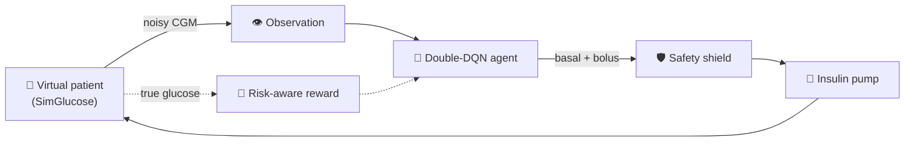
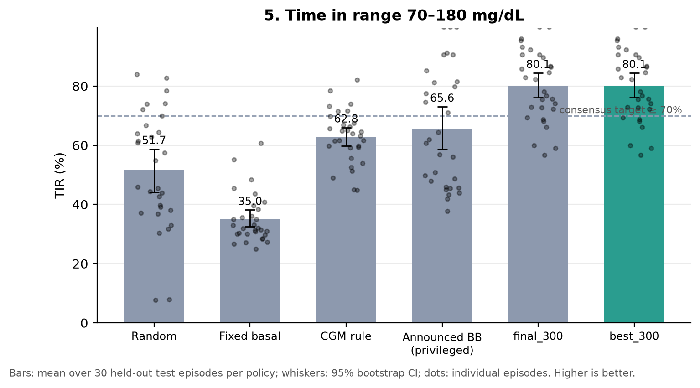
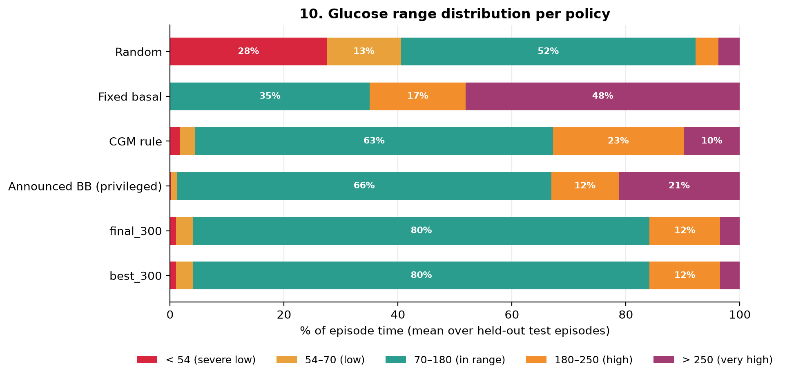
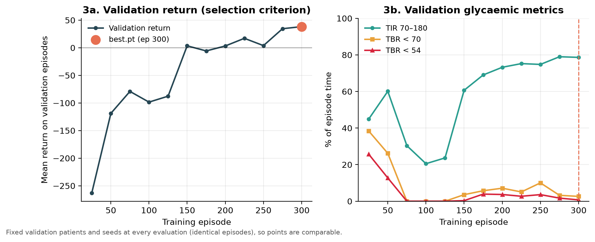
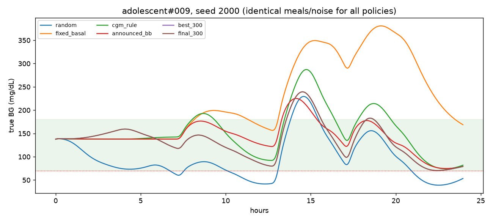

<div align="center">

# 🩸 Risk-Aware Reinforcement Learning for Type 1 Diabetes

### Dynamic Treatment Regime for Type 1 Diabetes Using Risk-Aware Reinforcement Learning

*A hypoglycaemia-averse Double-DQN that learns insulin dosing from noisy CGM data, tested on virtual patients it has never seen.*

<br>


**[Overview](#-highlights)** · **[Method](#-method-overview)** · **[Setup](#-installation)** · **[Run](#-execution-commands)** · **[Results](#-results)** · **[Reproduce](#-reproducing-the-results)**

</div>

> [!WARNING]
> **Research simulation only.** This is not a medical device and nothing here is clinical advice. Simulated results do not
> imply clinical performance.

---

## 📑 Table of contents

1. [✨ Highlights](#-highlights)
2. [🧠 Method overview](#-method-overview)
3. [📁 Project structure](#-project-structure)
4. [📦 Dependencies](#-dependencies)
5. [🔧 Installation](#-installation)
6. [✅ Verify the setup](#-verify-the-setup)
7. [🚀 Execution commands](#-execution-commands)
8. [📊 Results](#-results)
9. [🔁 Reproducing the results](#-reproducing-the-results)
10. [🎬 Web UI demo (optional)](#-web-ui-demo-optional)
11. [📜 Scope and disclaimer](#-scope-and-disclaimer)

---

## ✨ Highlights

| | Feature | What it means |
|---|---|---|
| 👁️ | **Partially observable (POMDP)** | The agent sees only recent noisy CGM readings, an estimated insulin-on-board and time of day. True blood glucose and meals are hidden. |
| ⚖️ | **Risk-aware reward** | In-range is rewarded; low glucose is penalised far more than high glucose. |
| 🛡️ | **Safety shield** | Insulin is suspended when glucose is low and unsafe boluses are blocked. |
| 🧑‍🤝‍🧑 | **Unseen-patient evaluation** | 18 train / 6 validation / 6 test virtual patients. Test patients are never used in training. |
| 🎯 | **Fair comparison** | All policies run the identical episodes (same patient, meals, sensor noise), with 95% bootstrap confidence intervals. |
| 📏 | **Four baselines** | Random, fixed basal, CGM-only rule, and a privileged announced-meal basal-bolus reference. |

---

## 🧠 Method overview

**Problem.** Choose insulin doses for a Type 1 diabetes patient every 15 minutes to keep glucose in the safe 70-180 mg/dL range,
while avoiding dangerous lows.



| Component | Design |
|---|---|
| 🧬 **Environment** | SimGlucose virtual patients wrapped as a Gymnasium POMDP; one decision every 15 minutes, 1 simulated day per episode |
| 👁️ **Observation** | Recent CGM history, estimated insulin-on-board, time of day |
| 💉 **Actions** | 16 discrete choices: 4 basal levels × 4 bolus sizes, scaled to each patient |
| 🎁 **Reward** | +1 in range, mild penalty for high glucose, strong penalty for low glucose (extra below 54 mg/dL) |
| 🛡️ **Safety** | Shield suspends insulin on low CGM and blocks unsafe boluses; hard dose caps always on |
| 🤖 **Agent** | Double-DQN with a small MLP Q-network, replay buffer and target network (custom PyTorch implementation) |
| 🧑‍🤝‍🧑 **Data split** | 30 virtual patients: 18 train / 6 validation (checkpoint selection) / 6 test (final report) |
| 📏 **Metrics** | Time in range (TIR), time below range (TBR), time above range (TAR), mean glucose, LBGI / HBGI, early-termination rate |

**Baselines** (all use the same dose caps and shield as the DQN):

- 🎲 `random`: random action (sanity floor).
- 💉 `fixed_basal`: constant basal insulin, never boluses.
- 📐 `cgm_rule`: simple hand-written rule using CGM only (a heuristic, not a clinical algorithm).
- 🔒 `announced_bb`: basal-bolus using privileged information (announced meals). It is not a fair competitor; it shows what
  meal knowledge buys.

---

## 📁 Project structure

<details open>
<summary><b>Click to collapse / expand</b></summary>

```
risk-aware-diabetes-rl/
├── t1d_env.py                # Gymnasium POMDP environment around SimGlucose (observation, actions, reward, shield)
├── dqn.py                    # Double-DQN agent
├── train_dqn.py              # Training (train patients) with checkpoint selection (validation patients)
├── evaluate.py               # Baselines vs trained agent on held-out patients
├── baselines.py              # random, fixed_basal, cgm_rule, announced_bb
├── rollout.py                # Episode runner / evaluation helpers
├── metrics.py                # TIR, TBR, TAR, LBGI, HBGI, ...
├── graphs.py                 # Generates the report figures and summary table
├── smoke_test_simglucose.py  # Checks the SimGlucose installation
├── test_wrapper.py           # Tests: environment, metrics, baselines, rollout
├── test_dqn.py               # Tests: DQN and training loop
├── requirements.txt
├── runs/
│   ├── dqn_risk_s0_300/      # config, training/validation logs, best.pt, final.pt
│   ├── eval_300_test_both/   # headline test-set evaluation
│   ├── eval_300_val/         # validation-set evaluation
│   └── eval_300_val_original/
├── graphs_results/           # Figures 01-10, traces.png, summary_table.md
├── backend/ + frontend/      # Optional web UI for live simulation and analysis
└── GlucoGuard_UI (2).mp4     # Web UI screen recording
```

</details>

---

## 📦 Dependencies

| Package | Version | Purpose |
|---|---|---|
| `simglucose` | 0.2.11 | Type 1 diabetes patient simulator, CGM sensor, insulin pump |
| `setuptools` | ≥ 77, < 81 | Needed by SimGlucose's legacy `gym` dependency (`pkg_resources`) |
| `gymnasium` | 0.29.1 | Environment API |
| `torch` | 2.14.1 | Deep Q-learning (CPU is enough) |
| `numpy` / `pandas` / `scipy` | 2.5.4 / 3.0.6 / 1.18.1 | Numerics and data handling |
| `matplotlib` | latest | Figures |
| `pytest` | latest | Tests |
| `fastapi`, `uvicorn[standard]`, `httpx` | latest | *Optional:* web UI backend |

Everything is listed in [`requirements.txt`](requirements.txt). The project has been run on Python 3.13.
The optional web UI additionally needs Node.js and npm.

---

## 🔧 Installation

```bash
git clone https://github.com/Radhika-789/risk-aware-diabetes-rl.git
cd risk-aware-diabetes-rl
```

<table>
<tr><th>🐧 Linux / 🍎 macOS</th><th>🪟 Windows (PowerShell)</th></tr>
<tr><td>

```bash
python -m venv .venv
source .venv/bin/activate
pip install -r requirements.txt
```

</td><td>

```powershell
python -m venv .venv
.venv\Scripts\Activate.ps1
pip install -r requirements.txt
```

</td></tr>
</table>

---

## ✅ Verify the setup

Run these from the repository root before training:

```bash
python smoke_test_simglucose.py        # simulator works
python test_wrapper.py                 # environment, metrics, baselines (~1-2 min, no torch needed)
python test_dqn.py                     # DQN and training loop (~1 min)
```

---

## 🚀 Execution commands

> [!NOTE]
> All commands are run from the **repository root** with the virtual environment active. The workflow is
> **train → evaluate → plot**.

### 1️⃣ Train

```bash
# quick pipeline check (a few minutes)
python train_dqn.py --episodes 12 --eval-every 6 --run-name quick

# full run used for the reported results (300 episodes, seed 0)
python train_dqn.py --episodes 300 --seed 0 --run-name dqn_risk_s0_300
```

Outputs go to `runs/<run-name>/`: training and validation logs, `best.pt` (best on validation), `final.pt`, `config.json`.

Useful flags: `--reward-mode {risk,tir}`, `--no-shield`, `--no-double`, `--announce-meals`, `--lr`, `--gamma`.
Run `python train_dqn.py --help` for all options.

### 2️⃣ Evaluate

```bash
# baselines only (no torch needed)
python evaluate.py --out results_baselines --episodes-per-patient 2

# baselines + trained checkpoints on the held-out test patients
python evaluate.py --split test --episodes-per-patient 5 \
    --checkpoints runs/dqn_risk_s0_300/best.pt runs/dqn_risk_s0_300/final.pt \
    --labels best_300 final_300 --out runs/eval_300_test_both --plot
```

Outputs: `episodes.csv`, `summary.csv`, `summary.md`, and `traces.png` (with `--plot`). `--split` accepts `test`, `val` or `train`.

### 3️⃣ Generate figures

```bash
python graphs.py --run runs/dqn_risk_s0_300 --eval runs/eval_300_test_both \
    --out graphs_results --dqn-label best_300
```

---

## 📊 Results

Held-out **test** patients: 6 patients × 5 episodes = **30 episodes per policy**, 1 simulated day each. Mean over episodes,
with the 95% bootstrap CI for TIR. Full table: [`graphs_results/summary_table.md`](graphs_results/summary_table.md).

| Policy | 🟢 TIR 70-180 % | 🟠 Time < 70 % | 🔴 Time < 54 % | 🟣 Time > 180 % | Mean BG (mg/dL) | Terminated early |
|---|---|---|---|---|---|---|
| 🎲 Random | 51.7 [44.0, 58.7] | 40.5 | 27.5 | 7.8 | 98 | 0.10 |
| 💉 Fixed basal | 35.0 [32.5, 38.1] | 0.0 | 0.0 | 65.0 | 276 | 0.23 |
| 📐 CGM rule | 62.8 [59.8, 66.0] | 4.4 | 1.7 | 32.8 | 168 | 0.03 |
| 🔒 Announced BB (privileged) | 65.6 [58.6, 73.0] | 1.2 | 0.2 | 33.1 | 201 | 0.13 |
| 🏆 **DQN (ours, `best.pt`)** | **80.1 [76.1, 84.4]** | 4.1 | 1.0 | 15.9 | 145 | **0.00** |

> [!TIP]
> The DQN reaches the consensus TIR target (≥ 70 %), has **no early terminations**, and clearly outperforms every baseline,
> including the privileged announced-meal reference, using only noisy CGM information.

### 📈 Key figures

#### 1️⃣ Time in range across policies
*30 held-out test episodes per policy; dots are individual episodes.*



#### 2️⃣ Where the time is spent
*Glucose range distribution per policy.*



#### 3️⃣ Learning curve
*Validation return and glycaemic metrics during training (the checkpoint-selection criterion).*



#### 4️⃣ Same patient, same meals, every policy
*True glucose traces over 24 h with identical meals and sensor noise.*



More plots are in [`graphs_results/`](graphs_results/): training return, training TIR, training loss, and TAR / TBR / severe
hypo / severe hyper comparisons.

---

## 🔁 Reproducing the results

The numbers and figures above can be regenerated with three commands (about **46 minutes** of CPU time for training, based on
the logged training time of the 300-episode run).

```bash
# 1️⃣ Train (seed 0, 300 episodes, default hyper-parameters; see runs/dqn_risk_s0_300/config.json)
python train_dqn.py --episodes 300 --seed 0 --run-name dqn_risk_s0_300

# 2️⃣ Evaluate on the 6 held-out test patients (5 episodes each = 30 per policy)
python evaluate.py --split test --episodes-per-patient 5 \
    --checkpoints runs/dqn_risk_s0_300/best.pt runs/dqn_risk_s0_300/final.pt \
    --labels best_300 final_300 --out runs/eval_300_test_both --plot

# 3️⃣ Figures and summary table
python graphs.py --run runs/dqn_risk_s0_300 --eval runs/eval_300_test_both \
    --out graphs_results --dqn-label best_300
```

<details>
<summary><b>🔎 Reproducibility notes</b></summary>

- **Fixed splits.** Train: patients 1-6, validation: 7-8, test: 9-10 of each group (adolescent, adult, child).
- **Fixed episodes.** Validation uses a fixed seed base at every evaluation. Test evaluation uses `--seed-base`
  (default 20,000,000), so every policy sees identical meals, noise and initial states.
- **Seeds.** `--seed` controls the training run. Exact numbers can still vary slightly across PyTorch versions and platforms,
  so compare against the confidence intervals rather than the last decimal.
- **Skip training.** The trained checkpoints are already included in `runs/dqn_risk_s0_300/`; running only steps 2 and 3
  reproduces the tables and figures.
- **Ablations.** Compare reward designs or the shield with `--reward-mode tir`, `--no-shield` and `--no-double` (use a
  different `--run-name` for each run).

</details>

---

## 🎬 Web UI demo (optional)

A small web UI (**GlucoGuard research workstation**) lets you run live glucose simulations with any policy, compare policies
side by side, and explore analytics and experiment results. It is a viewer on top of the RL project; none of the results above
depend on it.

<div align="center">

### [▶️ Watch the web UI demo video](GlucoGuard_UI%20%282%29.mp4)

<sub>Click to open the recording (MP4) stored in this repository.</sub>

</div>

<details>
<summary><b>▶️ How to run the web UI</b></summary>

Requires Node.js and npm. From the repository root, with the Python environment active:

```bash
cd frontend && npm install && npm run build && cd ..
uvicorn backend.app:app --port 8000      # open http://localhost:8000
```

To show the bundled evaluation results in the Analytics page, point the API at the `runs/eval_*` folders:

```bash
# Linux / macOS
GG_RESULTS_GLOB="runs/eval_*" uvicorn backend.app:app --port 8000
```

```powershell
# Windows (PowerShell)
$env:GG_RESULTS_GLOB = "runs/eval_*"
uvicorn backend.app:app --port 8000
```

For development with hot reload, run `uvicorn backend.app:app --reload --port 8000` in one terminal and
`cd frontend && npm run dev` in another (UI at http://localhost:5173).
API tests: `python -m pytest backend/tests -q`.

</details>

---

## 📜 Scope and disclaimer

- All results are obtained on SimGlucose virtual patients, evaluated on held-out patients never used in training or checkpoint
  selection.
- This work is for research and education only. It is not a medical device and not clinical advice.

---

<div align="center">

### 🙏 Acknowledgements

Built on [SimGlucose](https://github.com/jxx123/simglucose) (UVA/Padova T1D simulator),
[Gymnasium](https://gymnasium.farama.org/) and [PyTorch](https://pytorch.org/).

<sub>Made with 💙 for research and learning · Research simulation only</sub>

</div>