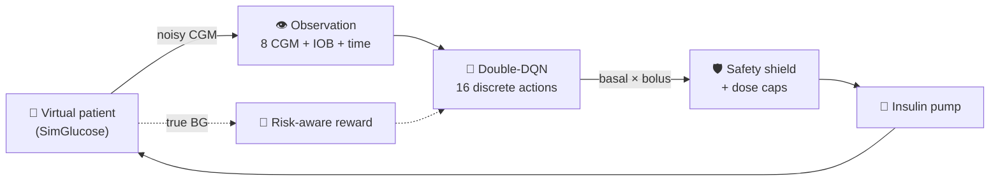

<div align="center">

# 🩸 Risk-Aware Reinforcement Learning for Type 1 Diabetes

### Dynamic Treatment Regime for Type 1 Diabetes Using Risk-Aware Reinforcement Learning

*A hypoglycaemia-averse Double-DQN that learns insulin dosing from noisy CGM data, tested on virtual patients it has never seen.*

<br>


**[Results](#-results)** · **[Frontend demo](#-frontend-demo)** · **[Install](#️-installation)** · **[Run](#️-execution-commands)** · **[Reproduce](#-reproducing-the-results)**

</div>

> [!WARNING]
> **Research simulation only.** This is not a medical device and nothing here is clinical advice. Simulated results do not
> imply clinical performance.

---

## 📑 Table of contents

1. [✨ Highlights](#-highlights)
2. [📊 Results](#-results)
3. [🎬 Frontend demo](#-frontend-demo)
4. [🗂️ Project structure](#️-project-structure)
5. [📦 Dependencies](#-dependencies)
6. [🛠️ Installation](#️-installation)
7. [▶️ Execution commands](#️-execution-commands)
8. [🔁 Reproducing the results](#-reproducing-the-results)
9. [🧪 Testing](#-testing)
10. [🧠 Method overview](#-method-overview)
11. [⚖️ Scope and disclaimer](#️-scope-and-disclaimer)

---

## ✨ Highlights

| | Feature | What it means |
|---|---|---|
| 👁️ | **Partially observable (POMDP)** | The agent sees only the last 8 noisy CGM readings, an estimated insulin-on-board and time of day. True BG, patient parameters and meals are hidden. |
| ⚖️ | **Risk-aware reward** | In-range is rewarded; hypoglycaemia is penalised far more than hyperglycaemia, with an extra penalty below 54 mg/dL. |
| 🛡️ | **Safety shield** | Insulin is suspended when CGM < 80 mg/dL and boluses that would push estimated IOB too high are blocked. Hard dose caps always apply. |
| 🧑‍🤝‍🧑 | **Unseen-patient evaluation** | 18 train / 6 validation / 6 test patients. Checkpoint chosen on validation; test patients are never touched in training. |
| 🎯 | **Fair comparison** | Every policy runs the *identical* episodes (same patient, meals, sensor noise). Metrics carry 95% bootstrap CIs. |
| 📏 | **Four baselines** | Random, fixed basal, CGM-only rule, and a privileged announced-meal basal-bolus reference. |
| 🖥️ | **Research workstation UI** | Live simulation, analytics, experiments and configuration pages. Nothing is synthesised: every value comes from a real SimGlucose step or a file written by the scripts. |

---

## 📊 Results

Held-out **test** patients: 6 patients × 5 episodes = **30 episodes per policy**, 1 simulated day each. Mean over episodes,
with the 95% bootstrap CI for TIR. Full table: [`graphs_results/summary_table.md`](graphs_results/summary_table.md).

| Policy | 🟢 TIR 70-180 % | 🟠 Time < 70 % | 🔴 Time < 54 % | 🟣 Time > 180 % | Mean BG (mg/dL) | Terminated early |
|---|---|---|---|---|---|---|
| 🎲 Random | 51.7 [44.0, 58.7] | 40.5 | 27.5 | 7.8 | 98 | 0.10 |
| 💉 Fixed basal | 35.0 [32.5, 38.1] | 0.0 | 0.0 | 65.0 | 276 | 0.23 |
| 📐 CGM rule | 62.8 [59.8, 66.0] | 4.4 | 1.7 | 32.8 | 168 | 0.03 |
| 🔒 Announced BB (privileged) | 65.6 [58.6, 73.0] | 1.2 | 0.2 | 33.1 | 201 | 0.13 |
| 🏆 **DQN (ours, `best.pt`)** | **80.1 [76.1, 84.4]** | 4.1 | 1.0 | 15.9 | 145 | **0.00** |

> [!TIP]
> The DQN reaches the consensus TIR target (≥ 70 %), has **no early terminations**, and clearly outperforms every baseline,
> including the privileged announced-meal reference, using only noisy CGM information.

### 📈 Key figures

#### 1️⃣ Time in range across policies
*30 held-out test episodes per policy; dots are individual episodes.*


#### 2️⃣ Where the time is spent
*Glucose range distribution per policy.*


#### 3️⃣ Learning curve
*Validation return and glycaemic metrics during training (the checkpoint-selection criterion).*


#### 4️⃣ Same patient, same meals, every policy
*True BG traces over 24 h with identical meals and sensor noise.*


More plots are in [`graphs_results/`](graphs_results/): training return, training TIR, training loss, and TAR / TBR / severe
hypo / severe hyper comparisons.

---

## 🎬 Frontend demo

The **GlucoGuard research workstation** is a web UI to run live glucose simulations with any policy, compare policies side by
side, explore analytics and experiment results, and inspect the model configuration.

<div align="center">

<!-- TODO: add screen recording (docs/demo.gif, or drag an .mp4 into the GitHub editor and paste the link here) -->


</div>

| Page | Route | What you can do |
|---|---|---|
| 🔴 **Live Simulation** | `/` | Pick a patient and policy, then run, pause or step a simulated day and watch glucose, actions and decisions update live. Compare policies on the same episode. |
| 📉 **Analytics Lab** | `/analytics` | Explore evaluation results across policies (time in range, time below / above range, per-episode metrics). |
| 🧫 **Experiments** | `/experiments` | Browse training runs, learning curves and evaluations. |
| ⚙️ **Configuration & Model** | `/config` | Inspect the environment settings and trained checkpoint details. |

---

## 🗂️ Project structure

<details open>
<summary><b>Click to collapse / expand</b></summary>

```
risk-aware-diabetes-rl/
├── t1d_env.py                # Gymnasium POMDP wrapper around SimGlucose (obs, actions, reward, shield, patient splits)
├── dqn.py                    # Double-DQN agent (MLP Q-network, replay buffer, target network)
├── train_dqn.py              # Training on train patients, checkpoint selection on validation patients
├── evaluate.py               # Baselines vs checkpoints on held-out patients (CSV, Markdown, traces)
├── baselines.py              # random, fixed_basal, cgm_rule, announced_bb
├── rollout.py                # Episode runner / policy evaluation helpers
├── metrics.py                # TIR, TBR, TAR, LBGI, HBGI, ...
├── graphs.py                 # Generates the 10 report figures + summary table
├── smoke_test_simglucose.py  # Verifies the SimGlucose installation
├── test_wrapper.py           # Tests: environment, metrics, baselines, rollout (plain script)
├── test_dqn.py               # Tests: DQN and training (plain script)
├── requirements.txt
├── backend/                  # FastAPI API (sessions, rollouts, evaluations, jobs) + backend/tests
├── frontend/                 # Vite + React 19 + TypeScript UI (+ e2e/ui_smoke.py)
├── runs/
│   ├── dqn_risk_s0_300/      # config.json, train_log.csv, val_log.csv, best.pt, final.pt
│   ├── eval_300_test_both/   # headline test-set evaluation
│   ├── eval_300_val/         # validation-set evaluation
│   └── eval_300_val_original/
├── graphs_results/           # Figures 01-10, traces.png, summary_table.md
└── docs/demo.gif             # Frontend screen recording
```

</details>

---

## 📦 Dependencies

### 🐍 Python

| Package | Version | Purpose |
|---|---|---|
| `simglucose` | 0.2.11 | T1D patient simulator, CGM sensor, insulin pump |
| `setuptools` | ≥ 77, < 81 | SimGlucose pulls in legacy `gym==0.9.4`, which needs `pkg_resources` |
| `gymnasium` | 0.29.1 | Environment API |
| `torch` | 2.14.1 | DQN (CPU is enough) |
| `numpy` / `pandas` / `scipy` | 2.5.4 / 3.0.6 / 1.18.1 | Numerics and data handling |
| `matplotlib` | latest | Figures |
| `pytest`, `httpx` | latest | Backend API tests |
| `fastapi`, `uvicorn[standard]` | latest | Backend server |
| `playwright` *(optional)* | latest | Only for `frontend/e2e/ui_smoke.py` |

All of the above except `playwright` are listed in [`requirements.txt`](requirements.txt). The project has been run on Python 3.13.

### ⚛️ Frontend

Node.js (a recent LTS release) and npm. React 19, React Router 7, Recharts 3, TanStack Query 5, Tailwind CSS 4, Vite 8,
TypeScript, oxlint. All are pinned in `frontend/package.json`.

---

## 🛠️ Installation

```bash
git clone https://github.com/Radhika-789/risk-aware-diabetes-rl.git
cd risk-aware-diabetes-rl
```

### 1️⃣ Python environment

<table>
<tr><th>🐧 Linux / 🍎 macOS</th><th>🪟 Windows (PowerShell)</th></tr>
<tr><td>

```bash
python -m venv .venv
source .venv/bin/activate
pip install -r requirements.txt
```

</td><td>

```powershell
python -m venv .venv
.venv\Scripts\Activate.ps1
pip install -r requirements.txt
```

</td></tr>
</table>

### 2️⃣ Verify the simulator

```bash
python smoke_test_simglucose.py
```

### 3️⃣ Frontend (only needed for the UI)

```bash
cd frontend
npm install
cd ..
```

---

## ▶️ Execution commands

> [!NOTE]
> All commands are run from the **repository root** with the virtual environment active.

### 🏋️ Train

```bash
# quick pipeline check (a few minutes)
python train_dqn.py --episodes 12 --eval-every 6 --run-name quick

# full run used for the reported results (300 episodes, seed 0)
python train_dqn.py --episodes 300 --seed 0 --run-name dqn_risk_s0_300
```

Outputs go to `runs/<run-name>/`: `train_log.csv`, `val_log.csv`, `best.pt`, `final.pt`, `config.json`.

Useful flags: `--reward-mode {risk,tir}`, `--no-shield`, `--no-double`, `--announce-meals`, `--history-len`, `--lr`, `--gamma`,
`--eps-decay-frac`, `--eval-every`. Run `python train_dqn.py --help` for all options.

### 🧮 Evaluate

```bash
# baselines only (no torch needed)
python evaluate.py --out results_baselines --episodes-per-patient 2

# baselines + trained checkpoints on the held-out test patients
python evaluate.py --split test --episodes-per-patient 5 \
    --checkpoints runs/dqn_risk_s0_300/best.pt runs/dqn_risk_s0_300/final.pt \
    --labels best_300 final_300 --out runs/eval_300_test_both --plot
```

Outputs: `episodes.csv`, `summary.csv`, `summary.md`, and `traces.png` (with `--plot`). `--split` accepts `test`, `val` or `train`.

### 🎨 Generate figures

```bash
python graphs.py --run runs/dqn_risk_s0_300 --eval runs/eval_300_test_both \
    --out graphs_results --dqn-label best_300
```

### 🌐 Run the UI

**Development mode (hot reload)**, in two terminals:

```bash
# terminal 1: API (repo root)
uvicorn backend.app:app --reload --port 8000

# terminal 2: UI
cd frontend
npm run dev            # http://localhost:5173  (/api is proxied to :8000)
```

**Single-process mode** (FastAPI serves the built UI):

```bash
cd frontend && npm run build && cd ..
uvicorn backend.app:app --port 8000      # http://localhost:8000
```

> [!IMPORTANT]
> **Showing the bundled evaluation results in the Analytics page.** The API looks for evaluation folders matching `results*` by
> default, while this repo stores them under `runs/eval_*`. Point it there with an environment variable:

```bash
# Linux / macOS
GG_RESULTS_GLOB="runs/eval_*" uvicorn backend.app:app --port 8000
```

```powershell
# Windows (PowerShell)
$env:GG_RESULTS_GLOB = "runs/eval_*"
uvicorn backend.app:app --port 8000
```

Other environment variables: `GG_RUNS_DIR` (default `runs`).

**⌨️ Keyboard shortcuts (Live Simulation):**

| Key | Action | Key | Action |
|---|---|---|---|
| `Space` | Run / pause | `R` | Reset |
| `N` | Step | `[` | Toggle sidebar |
| `Shift+N` | Step ×4 | `Esc` | Close drawers |

---

## 🔁 Reproducing the results

The numbers and figures above can be regenerated with three commands (about **46 minutes** of CPU time for training, based on
the logged training time of the 300-episode run).

```bash
# 1️⃣ Train (seed 0, 300 episodes, default hyper-parameters; see runs/dqn_risk_s0_300/config.json)
python train_dqn.py --episodes 300 --seed 0 --run-name dqn_risk_s0_300

# 2️⃣ Evaluate on the 6 held-out test patients (5 episodes each = 30 per policy)
python evaluate.py --split test --episodes-per-patient 5 \
    --checkpoints runs/dqn_risk_s0_300/best.pt runs/dqn_risk_s0_300/final.pt \
    --labels best_300 final_300 --out runs/eval_300_test_both --plot

# 3️⃣ Figures and summary table
python graphs.py --run runs/dqn_risk_s0_300 --eval runs/eval_300_test_both \
    --out graphs_results --dqn-label best_300
```

<details>
<summary><b>🔎 Reproducibility notes</b></summary>

- **Fixed splits.** Train: patients 1-6, validation: 7-8, test: 9-10 of each group (adolescent, adult, child).
- **Fixed episodes.** Validation uses a fixed seed base (10,000,000) at every evaluation. Test evaluation uses `--seed-base`
  (default 20,000,000), so every policy sees identical meals, noise and initial states.
- **Seeds.** `--seed` controls the training run. Exact numbers can still vary slightly across PyTorch versions and platforms,
  so compare against the CIs rather than the last decimal.
- **Skip training.** The trained checkpoints are already included in `runs/dqn_risk_s0_300/`; running only steps 2 and 3
  reproduces the tables and figures.
- **Ablations.** Compare reward designs or the shield with `--reward-mode tir`, `--no-shield` and `--no-double` (use a
  different `--run-name` for each run).

</details>

---

## 🧪 Testing

```bash
python test_wrapper.py                 # environment, metrics, baselines, rollout (~1-2 min, no torch needed)
python test_dqn.py                     # DQN + training loop (~1 min)
python -m pytest backend/tests -q      # API tests
```

<details>
<summary><b>🌍 Optional: browser smoke test and frontend checks</b></summary>

Headless Chromium, needs a built UI and a running API on port 8000:

```bash
pip install playwright && playwright install chromium
cd frontend && npm run build && cd ..
uvicorn backend.app:app --port 8000     # in another terminal
python frontend/e2e/ui_smoke.py
```

Frontend lint and type-check: `cd frontend && npm run lint && npm run build`.

</details>

---

## 🧠 Method overview



| Component | Design |
|---|---|
| 🧬 Simulator | SimGlucose core simulator (patient + Dexcom CGM + pump + random meal scenario) |
| ⏱️ Decision interval | 15 minutes (5 sensor samples), action held |
| 👁️ Observation (11-dim) | last 8 CGM readings / 400, estimated IOB, sin/cos of time of day (+ meal grams only if `--announce-meals`) |
| 💉 Actions (16 discrete) | basal multiplier {0, 0.5, 1.0, 1.5} × bolus {0, 0.03, 0.06, 0.12} × total daily insulin |
| 🎁 Reward (per interval, from true BG) | +1 in range; mild linear hyper penalty; strong hypo penalty with extra below 54 mg/dL; terminal penalty if the simulator ends the episode |
| 🛡️ Safety shield | suspend insulin if CGM < 80; block boluses that push estimated IOB above 0.20 × TDI; hard dose caps always on |
| 🤖 Agent | Double-DQN, MLP 128-128, replay buffer 100k, hard target copy every 500 steps, Huber loss, linear epsilon decay 1.0 → 0.05 |
| 🧑‍🤝‍🧑 Patients | 30 virtual patients, group-stratified: 18 train / 6 validation / 6 test |
| 📏 Metrics | TIR (70-180), TBR (< 70, < 54), TAR (> 180, > 250), mean BG, LBGI, HBGI, early-termination rate, return |

**Baselines** (all act through the same wrapper, caps and shield as the DQN):

- 🎲 `random`: uniformly random action (sanity floor).
- 💉 `fixed_basal`: nominal basal, never boluses.
- 📐 `cgm_rule`: untuned hand-written CGM-only rule over the same discrete actions (a heuristic, not a clinical algorithm).
- 🔒 `announced_bb`: basal-bolus using privileged information (announced meals, patient carb ratio and correction factor). It is
  not a fair POMDP competitor; it shows what meal knowledge buys.

---

## ⚖️ Scope and disclaimer

- All results are obtained on SimGlucose virtual patients, evaluated on held-out patients never used in training or checkpoint
  selection.
- This work is for research and education only. It is not a medical device and not clinical advice.

---

<div align="center">

### 🙏 Acknowledgements

Built on [SimGlucose](https://github.com/jxx123/simglucose) (UVA/Padova T1D simulator),
[Gymnasium](https://gymnasium.farama.org/) and [PyTorch](https://pytorch.org/).

<sub>Made with 💙 for research and learning · Research simulation only</sub>

</div>